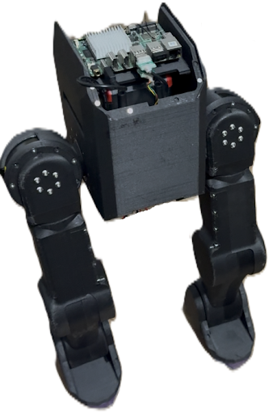
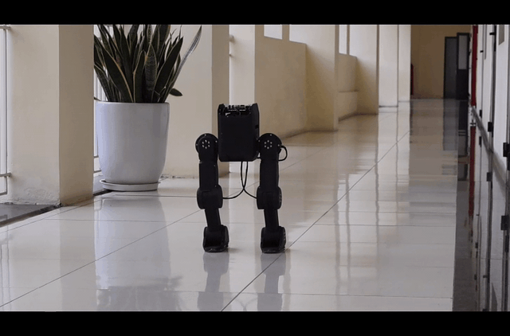
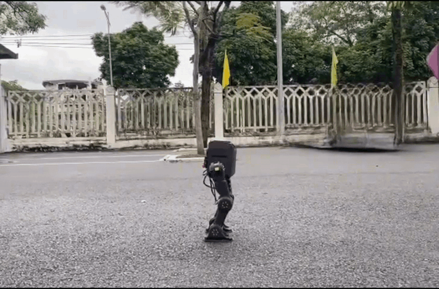
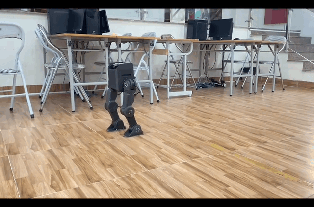
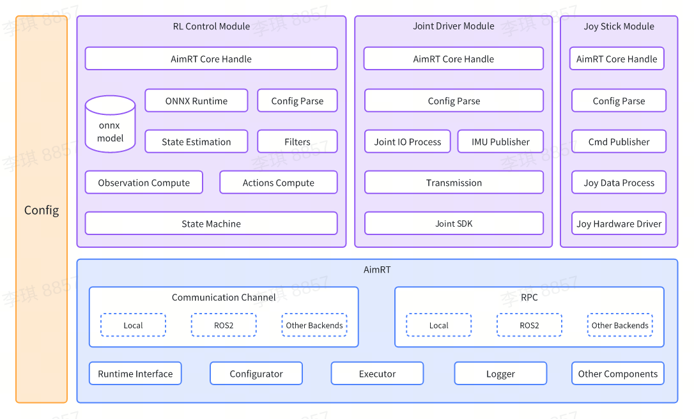

# Readme

English | [TIẾNG VIỆT](README.vi_VN.md)

## Introduction

Mybipedal is a modular bipedal robot with 10 dof each legs developed and opensource by me. It is built upon AgiBot's open-source framework AimRT as middleware and using reinforcement learning for locomotion control.
This project is about the accompanying software for MyBipedal, including multiple functional modules such as model inference, platform driver, and software simulation.

For detailed tutorials on `AimRT` framework, please visit the [AimRT official website](https://aimrt.org/).








## Software Architecture Diagram



For detailed annotations of modules, please refer to the [Development Guide](doc/tutorials.md).

## Directory Structure

```bash
src/
├── protocols/my_ros2_proto/     # ROS 2 msg/srv definitions (JointCommand, JoyStickData)
├── module/
│   ├── joint_driver_module/     # CAN bus → Robstride actuators, transmission transforms
│   ├── joy_stick_module/        # SDL2 joystick + QP velocity limiter (qpOASES)
│   ├── control_module/          # RL + PD + state machine, ONNX inference, IMU est.
│   ├── oled_module/             # Oled logging and debugging module for efficient visual debugging
│   ├── imu_module/              # DM IMU L1 driver (serial, 921600 baud)
│   └── sim_module/              # MuJoCo physics + GLFW renderer
├── pkg/pkg1/                    # Package entry point, registers all modules
└── install/linux/bin/           # YAML configs + run scripts
    ├── run.sh                   # Real hardware mode launcher
    └── run_sim.sh               # Simulation mode launcher
```

## Running Instructions

### Preparation for Launch

- Install [GCC-13](https://www.gnu.org/software/gcc/gcc-13/).

- Install [cmake](https://cmake.org/download/) (version 3.26 or above).

- Install [ONNX Runtime](https://github.com/microsoft/onnxruntime) for Intel X86 architecture.

```bash
sudo apt update
sudo apt install -y build-essential cmake git libprotobuf-dev protobuf-compiler

git clone --recursive https://github.com/microsoft/onnxruntime

cd onnxruntime
./build.sh --config Release --build_shared_lib --parallel

cd build/Linux/Release/
sudo make install
```
- Install [ONNX Runtime](https://github.com/microsoft/onnxruntime) for Arm64 architecture.

```bash
git clone --recursive -b v1.19.2 https://github.com/microsoft/onnxruntime
cd ~/onnxruntime
sed -i 's/be8be39fdbc6e60e94fa7870b280707069b5b81a/32b145f525a8308d7ab1c09388b2e288312d8eba/' cmake/deps.txt
./build.sh --config Release --build_shared_lib --parallel 2 \
  --skip_tests \
  --cmake_extra_defines CMAKE_POLICY_VERSION_MINIMUM=3.5 onnxruntime_BUILD_UNIT_TESTS=OFF
# Copy to Mybipedal third party libraries folder
cd ~/Mybipedal/src/module/control_module/third_party/lib
cp ~/onnxruntime/build/Linux/Release/libonnxruntime.so.1.19.2 .
cp ~/onnxruntime/build/Linux/Release/libonnxruntime_providers_shared.so .

ln -sf libonnxruntime.so.1.19.2 libonnxruntime.so.1
ln -sf libonnxruntime.so.1 libonnxruntime.so
```
- Install `ROS2 Humble` and configure the environment variables. For detailed instructions, visit the [ROS2 official website](https://docs.ros.org/en/humble/Installation/Ubuntu-Install-Debians.html).

- Install dependencies for the simulation environment.

```bash
sudo apt install jstest-gtk libglfw3-dev libdart-external-lodepng-dev
```

- Install the Linux [realtime kernel patch](https://wiki.linuxfoundation.org/realtime/start) if real-robot debugging is needed.

*It will be very slow or even fail to download AimRT's numerous dependencies from default sources. Therefore, we provide environment variables `DOWNLOAD_FLAGS` for the download based on the Gitee source in `url_gitee.bashrc`. Simply source `url_gitee.bashrc` before running `build.sh` and add environment variable parameters for the Gitee source.*

After completing the above steps, execute the following commands in the terminal:

```bash
source /opt/ros/humble/setup.bash
source url_gitee.bashrc

# Build
./build.sh $DOWNLOAD_FLAGS

# Test
./test.sh $DOWNLOAD_FLAGS

# Custom cmake options:
cmake -B build -DCMAKE_BUILD_TYPE=Release \
  -DMYBIPEDAL_DEPLOY_BUILD_TESTS=ON \
  -DMYBIPEDAL_DEPLOY_SIMULATION=ON
cmake --build build --config Release --target install --parallel "$(nproc)"

# Single module rebuild (after editing one module):
cmake --build build --target pkg1  # rebuilds libpkg1.so
cmake --build build --target install  # copies to build/bin
```

### Launch Simulation

Before starting, it is necessary to connect the handle USB dongle receiver.

```bash
cd build/
./run_sim.sh
```

### Launch on Real Robot

```bash
# Hardware mode (requires CAN bus + hardware)
cd build/
./run.sh
# If program cannot run on Radxa 5b+ when executing ./run.sh try this:
sudo LD_LIBRARY_PATH=/opt/ros/humble/lib ./run.sh

```

### Joystick Control

For specific control instructions, please refer to the [Joystick Control Module](doc/joy_stick_module/joy_stick_module.md).

## License Agreement

The code provided in this project runs on the [AimRT](https://aimrt.org/) framework. This is research code subject to frequent changes, and cannot apply to all specific purposes. The source code is released under the [MULAN](https://spdx.org/licenses/MulanPSL-2.0.html) license agreement.

## Important Notes

- **C++20 required**, GCC 13 enforced via `build.sh` (CC=/usr/bin/gcc-13)
- Module parameters (gains, limits, state machine config) are in YAML, not hardcoded
- The bundled third-party libs (ONNX Runtime, MuJoCo, qpOASES, DM IMU, Robstride) are in `control_module/third_party/`, `sim_module/third_party/`, `joy_stick_module/third_party/`, `joint_driver_module/robstride_controller/`, `imu_module/dm_imu_l1/`
