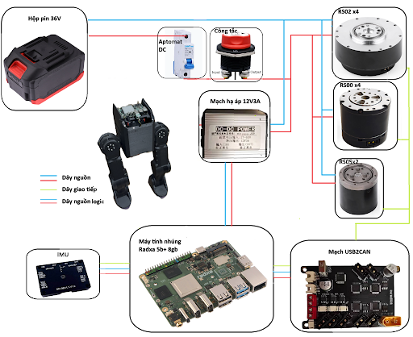
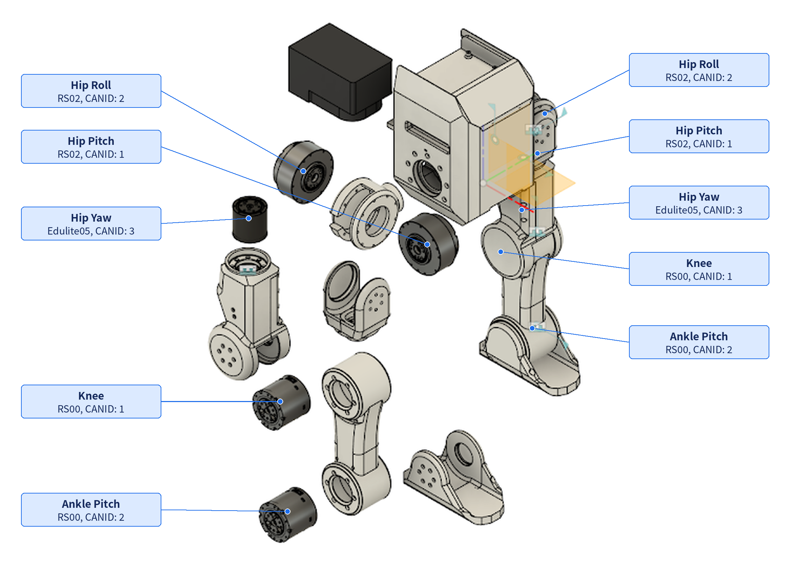
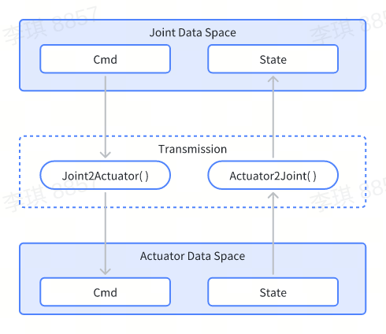

# DCU Driver Module

## Introduction

JointDriver can transmit CAN message data via the USB2CAN module with a refresh rate of up to 500Hz. USB2CAN module has four CAN buses, with each bus capable of connecting up to 3 Robstride actuators in series.

I provide an SDK in the `src/module/joint_driver_module/robstride_controller` directory. This directory is a standalone C++ software package independent of AimRT, allowing developers to extract and use it to build their projects. For an SDK example, refer to [RobstrideController Example](/src/module/joint_driver_module/robstride_controller/example/main.cpp).

The Joint Driver Module further encapsulates the SDK and adapts to the AimRT software framework. We have added the transmission layer and data processing modules to the Joint Driver Module, so it can provide joint control interfaces.

***Note:  Developers need to install the PREEMPT_RT real-time kernel patch to run the SDK on the real robot for reduce the latency of normal OS scheduler.***

### Check the Real-time Kernel

- uname -a

  PREEMPT_RT appears, such as Linux Console 6.1.59-rt16 #2 SMP PREEMPT_RT Tue Feb 20 17:36:21 CST 2024 x86_64 x86_64 x86_64 GNU/Linux.

- cat /sys/kernel/realtime

  The path exists and the value is 1.

## Communication Topology

### Hardware System Architecture

As shown in the diagram below, the Radxa 5b+ ARM64 connects to the USB2CAN module the USB. The system diagram clearly shows the communication topology of the joints in series.




### Joint ID Assignment

Assign all joint IDs in the order shown in the diagram below. For the complete set, the ID labels are attached to the actuators by default. Please check them carefully.



## Module Inputs and Outputs

To facilitate debugging with ROS2, some data types are natively supported by ROS2.

| Topic                | Description                                         | Data Type                            |
| -------------------- | --------------------------------------------------- | ------------------------------------ |
| /joint_cmd           | Input for downstream joint control                  | my_ros2_proto::msg::JointCommand     |
| /joint_states        | Output for upstream joint data                      | sensor_msgs::msg::JointState         |

### About /joint_cmd

```bash
std_msgs/Header header

string[] name
float64[] position
float64[] velocity
float64[] effort
float64[] stiffness
float64[] damping
```

/joint_cmd uses joint names as indices and employs a data type specifically for `hybrid force/position control`. All rotary joints support this control type.

## Parameter Configuration

The parameters of the Joint Driver Module are described in the field `JointDriverModule` of the [Configuration File](/src/install/linux/bin/cfg/mybipedal_cfg.yaml) with detailed comments.

Developers need to correctly configure the `driver_network` field according to the actual joint connections of the robot.

## About the Transmission Layer



In the program, downstream and upstream data are transmitted through the joint space and actuator space.

Upon the reception of downstream data, the module will cache it into the joint space by the joint name. After conversion in the transmission layer, the module will cache the data into the corresponding actuator space, and then distribute it via the SDK. The same process applies to upstream data.

Joints and actuators are bound through the transmission layer, and the detailed binding relationships are specified in the `transmission` field of the configuration file.